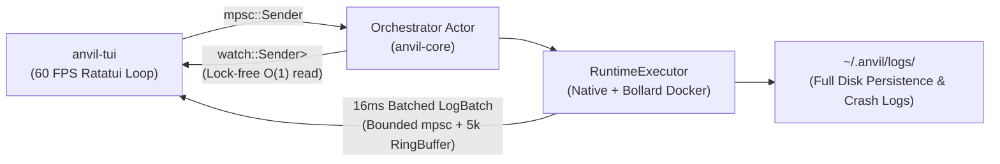
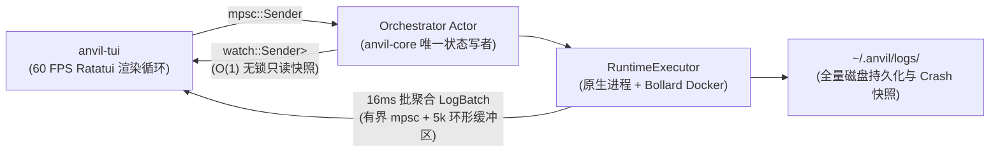

# Anvil

[English](#english) | [简体中文](#简体中文)

---

<a id="english"></a>

## English

**A Rust-native local development environment orchestrator (CLI + TUI) unifying host processes, Docker containers, DAG dependency scheduling, and OS-level process tree hygiene.**

[](https://www.rust-lang.org/)
[](https://tokio.rs/)
[](https://ratatui.rs/)
[](https://github.com/fussybeaver/bollard)
[](#)

### Why Anvil?

Modern full-stack development routinely mixes stateful infrastructure containers (PostgreSQL, Redis, Kafka) with native host processes (`cargo run`, `go run`, `pnpm dev`). Existing tools leave critical gaps:

| Capability | **Anvil** | `docker compose` | `Overmind` / `Foreman` | `Turborepo` |
| :--- | :---: | :---: | :---: | :---: |
| **Native + Docker Unified DAG** | ✅ First-class | ❌ Containers only | ❌ Processes only | ❌ JS/TS monorepos |
| **Readiness-Gated Startup** | ✅ TCP / HTTP / LogRegex / DockerHealth | ⚠️ Healthcheck only | ❌ Fire-and-forget | ⚠️ Task exit only |
| **True Process Tree Destruction** | ✅ Unix PGID + Win32 Job Object | ✅ Container isolation | ⚠️ Signal leaks on grandchildren | ⚠️ Node tree gaps |
| **Interactive Port Conflict Rescue** | ✅ Inspect PID/Cmd + 1-key kill & retry | ❌ Fails on bind | ❌ Fails on bind | ❌ Fails on bind |
| **Secret Isolation (Zero Plaintext)** | ✅ OS Keychain + AES-256-GCM + `zeroize` | ⚠️ `.env` plaintext files | ⚠️ `.env` plaintext files | ⚠️ `.env` plaintext files |
| **Single Static Binary & Cold Start** | ✅ Milliseconds (Rust) | ⚠️ Go CLI + Daemon | ⚠️ Requires `tmux` | ❌ Node.js runtime |

### Core Capabilities

- **Declarative Hybrid DAG Orchestration (`anvil.yaml`)**: Define native host processes, standalone Docker containers, and `docker compose` services in one manifest. Built-in cycle detection with exact cycle-path diagnostics and event-driven topological wave execution.
- **Multi-Modal Readiness Probes**: Downstream services wait automatically until upstream dependencies pass `tcp`, `http`, `log_regex`, or `docker_health` readiness checks.
- **Zero-Orphan Cross-Platform Process Management**:
  - **Unix (macOS / Linux)**: Isolates child subtrees via `setpgid(0, 0)` and performs two-phase termination (`SIGTERM` -> grace period -> `SIGKILL`) across the entire process group (`killpg`).
  - **Windows**: Binds child processes to Win32 Job Objects with `JOB_OBJECT_LIMIT_KILL_ON_JOB_CLOSE` so even unexpected crashes leave zero stray grandchildren.
  - **PID-Reuse-Safe Crash Recovery**: Persists `{ pid, pgid, start_time_secs }` fingerprints in `~/.anvil/run/<project>.lock.json` and validates kernel process start timestamps before reaping leftovers on restart.
- **Interactive Port Conflict Resolution**: Fast pre-flight bind probe (`TcpListener`) falls back to OS socket table + `sysinfo` process inspection upon collision, letting you inspect the occupying PID/command and press `k` in the TUI to terminate and retry seamlessly.
- **Zero-Plaintext Secret Vault**: Reference secrets in `anvil.yaml` via `${SECRET:KEY}`. Values live in your OS native keychain (with an Argon2id + AES-256-GCM encrypted local fallback for headless environments) and are injected directly into child memory wrapped in `zeroize::Zeroizing<String>`.
- **60 FPS Lock-Free TUI Workbench**: Powered by `ratatui` + `crossterm` with ANSI color log rendering, scroll locking, live keyword filtering, per-service hot restart, and automatic crash snapshot persistence (`~/.anvil/logs/<project>/<service>-crash.log`).

### System Architecture

Anvil enforces a **Single-Writer Actor** state model decoupled from UI rendering via lock-free snapshots and bounded, backpressure-protected Tokio channels:



### Example `anvil.yaml`

```yaml
version: "1"
project:
  name: "nebula-commerce"

secrets:
  - DB_PASSWORD
  - JWT_PRIVATE_KEY

services:
  postgres:
    runtime:
      type: docker_container
      image: "postgres:16-alpine"
      ports: ["5432:5432"]
    port: 5432
    env:
      POSTGRES_PASSWORD: "${SECRET:DB_PASSWORD}"
    readiness_probe:
      type: tcp
      port: 5432

  api-gateway:
    runtime:
      type: native
      cmd: "cargo run -p nebula-api"
      cwd: "./backend"
    port: 8080
    depends_on: [postgres]
    env:
      DATABASE_URL: "postgres://postgres:${SECRET:DB_PASSWORD}@127.0.0.1:5432/app"
      JWT_SECRET: "${SECRET:JWT_PRIVATE_KEY}"
    readiness_probe:
      type: http
      url: "http://127.0.0.1:8080/healthz"

  web-console:
    runtime:
      type: native
      cmd: "pnpm run dev --port 3000"
      cwd: "./frontend"
    port: 3000
    depends_on: [api-gateway]
    readiness_probe:
      type: log_regex
      pattern: "Local:\\s+http://localhost:3000"
```

### TUI Keybindings (Planned)

| Key | Action |
| :--- | :--- |
| `j` / `k` or `↑` / `↓` | Select service in the DAG topology tree |
| `r` | Graceful hot-restart of the selected service |
| `K` (or `k` in modal) | Terminate conflicting external process on port collision & retry |
| `/` | Live keyword filter across the active service log ring buffer |
| `s` | Toggle auto-scroll lock in the log pane |
| `Tab` | Switch between registered project workspaces |
| `q` / `Ctrl+C` | Reverse-topological graceful shutdown of all services & cleanup |

### Cargo Workspace Layout

```text
crates/
├── anvil-cli       # Clap CLI router (up, down, ps, logs, secret, doctor) & panic hooks
├── anvil-core      # YAML schema, DAG scheduler, ServiceState machine, probes, Orchestrator
├── anvil-runtime   # RuntimeExecutor implementations (Native tokio::process + Bollard Docker)
├── anvil-sys       # Unix PGID, Win32 Job Objects, port inspection, PID-reuse-safe reaper
├── anvil-secret    # OS Keychain + AES-256-GCM fallback vault + Zeroizing placeholder resolver
└── anvil-tui       # Ratatui 60 FPS terminal workbench & interactive modals
```

### Development Roadmap

- [ ] **Milestone 1**: Cargo Workspace setup, `anvil-secret` vault/resolver, `anvil.yaml` parser/validator, DAG scheduler & `ServiceState`
- [ ] **Milestone 2**: `anvil-sys` cross-platform process tree destruction, port conflict inspector & orphan reaper
- [ ] **Milestone 3**: `anvil-runtime` Native + Bollard Docker executors & multi-modal readiness probes
- [ ] **Milestone 4**: `anvil-core` event-driven `Orchestrator` Actor, 16ms batched log ring buffer & crash persistence
- [ ] **Milestone 5**: `anvil-tui` 60 FPS workbench & `anvil-cli` full command suite

---

<a id="简体中文"></a>

## 简体中文

**基于 Rust 原生构建的本地全栈开发环境编排器（CLI + TUI）—— 将宿主机进程、Docker 容器、DAG 拓扑调度与内核级进程树清理融为一体。**

### 为什么需要 Anvil？

现代全栈本地开发通常需要同时管理有状态基础设施容器（PostgreSQL、Redis、Kafka）与宿主机原生业务进程（`cargo run`、`go run`、`pnpm dev`）。现有工具在跨界编排与系统级管控上存在明显短板：

| 核心能力 | **Anvil** | `docker compose` | `Overmind` / `Foreman` | `Turborepo` |
| :--- | :---: | :---: | :---: | :---: |
| **原生进程 + Docker 统一 DAG** | ✅ 一等公民统一编排 | ❌ 仅限容器 | ❌ 仅限进程 | ❌ 偏重 JS/TS Monorepo |
| **多模态就绪探针门控** | ✅ TCP / HTTP / 日志正则 / DockerHealth | ⚠️ 仅容器 Healthcheck | ❌ 启动后即放任 | ⚠️ 仅任务退出码 |
| **跨平台进程树彻底销毁** | ✅ Unix 进程组 + Win32 Job Object | ✅ 容器隔离 | ⚠️ 多层子进程易产生信号泄漏 | ⚠️ Node 进程树残留 |
| **交互式端口冲突救援** | ✅ 反查占用 PID/命令 + 一键强杀重试 | ❌ 绑定失败直接退出 | ❌ 绑定失败直接退出 | ❌ 绑定失败直接退出 |
| **敏感凭证零明文隔离** | ✅ 系统钥匙串 + AES-256-GCM + `zeroize` | ⚠️ `.env` 明文文件 | ⚠️ `.env` 明文文件 | ⚠️ `.env` 明文文件 |
| **单二进制分发与冷启动** | ✅ 毫秒级冷启动（Rust 原生） | ⚠️ Go CLI + 守护进程 | ⚠️ 依赖 `tmux` | ❌ 依赖 Node.js 运行时 |

### 核心特性

- **声明式混合 DAG 编排 (`anvil.yaml`)**：在同一份配置文件中统一管理宿主机原生进程、独立 Docker 容器与 `docker compose` 服务；内置有向无环图环路检测（精准报错环路径）与事件驱动的波次并发启动。
- **多模态就绪探针 (`Readiness Probe`)**：下游服务自动等待上游依赖通过 `tcp`、`http`、`log_regex` 或 `docker_health` 探针后才触发启动，彻底告别手写 `sleep` 等待脚本。
- **跨平台零孤儿进程管理**：
  - **Unix (macOS / Linux)**：通过 `setpgid(0, 0)` 将子进程隔离至独立进程组，停止时执行两阶段清场（先广播 `SIGTERM` 给予优雅退出宽限期，超时后对整个进程组 `killpg` 发送 `SIGKILL`）。
  - **Windows**：将子进程绑定至启用了 `JOB_OBJECT_LIMIT_KILL_ON_JOB_CLOSE` 的 Win32 Job Object，即使主程序意外终止，内核也会自动销毁整棵派生进程树。
  - **PID 回绕安全防护**：将 `{ pid, pgid, start_time_secs }` 进程启动时间戳指纹记录于 `~/.anvil/run/<project>.lock.json`，崩溃重启自检时校验时间戳一致才回收残留进程，严防系统 PID 复用误杀无辜进程。
- **交互式端口冲突处置**：启动前使用 `TcpListener::bind` 进行毫秒级快速预检；发生占用冲突时自动通过 OS Socket 表与 `sysinfo` 反查外部占用进程的 PID、进程名及完整命令行，在 TUI 中按 `k` 即可一键终止并无缝重试启动。
- **敏感配置零明文隔离**：`anvil.yaml` 中使用 `${SECRET:KEY}` 占位符声明敏感变量，可安全提交至 Git；实际密钥存放于系统原生钥匙串（或无桌面环境下的 Argon2id + AES-256-GCM 加密文件），启动服务时通过 `zeroize::Zeroizing<String>` 直接注入内存并自动清零。
- **60 FPS 无锁响应式 TUI 工作台**：基于 `ratatui` + `crossterm` 实现左右分屏布局，支持 ANSI 原色日志渲染、16ms 批聚合背压保护与定长 5,000 行环形缓冲区、滚动锁定、关键字实时过滤、单服务热重启以及崩溃上下文自动落盘（`~/.anvil/logs/<project>/<service>-crash.log`）。

### 系统架构与并发通信模型

Anvil 采用 **Single-Writer Actor（单写者状态引擎）** 架构，通过无锁快照与有界背压通道将核心调度逻辑与终端渲染彻底解耦：



### `anvil.yaml` 配置示例

```yaml
version: "1"
project:
  name: "nebula-commerce"

secrets:
  - DB_PASSWORD
  - JWT_PRIVATE_KEY

services:
  postgres:
    runtime:
      type: docker_container
      image: "postgres:16-alpine"
      ports: ["5432:5432"]
    port: 5432
    env:
      POSTGRES_PASSWORD: "${SECRET:DB_PASSWORD}"
    readiness_probe:
      type: tcp
      port: 5432

  api-gateway:
    runtime:
      type: native
      cmd: "cargo run -p nebula-api"
      cwd: "./backend"
    port: 8080
    depends_on: [postgres]
    env:
      DATABASE_URL: "postgres://postgres:${SECRET:DB_PASSWORD}@127.0.0.1:5432/app"
      JWT_SECRET: "${SECRET:JWT_PRIVATE_KEY}"
    readiness_probe:
      type: http
      url: "http://127.0.0.1:8080/healthz"

  web-console:
    runtime:
      type: native
      cmd: "pnpm run dev --port 3000"
      cwd: "./frontend"
    port: 3000
    depends_on: [api-gateway]
    readiness_probe:
      type: log_regex
      pattern: "Local:\\s+http://localhost:3000"
```

### TUI 快捷键一览（规划）

| 快捷键 | 功能描述 |
| :--- | :--- |
| `j` / `k` 或 `↑` / `↓` | 在左侧 DAG 服务拓扑树中切换选中服务 |
| `r` | 优雅停止并热重启当前选中的单个服务 |
| `K`（或弹窗内按 `k`） | 一键强杀占用端口的外部进程并重试启动 |
| `/` | 在当前服务日志缓冲区中实时按关键字过滤与高亮 |
| `s` | 切换日志面板的自动滚动锁定状态 |
| `Tab` | 在多个已注册的项目工作区之间快速切换 |
| `q` / `Ctrl+C` | 按逆拓扑顺序优雅停止所有服务并清理全部进程树 |

### Cargo Workspace 模块划分

```text
crates/
├── anvil-cli       # Clap 命令行路由 (up, down, ps, logs, secret, doctor) 与终端 Panic 恢复 Hook
├── anvil-core      # YAML 协议校验、DAG 调度器、ServiceState 状态机、就绪探针、Orchestrator Actor
├── anvil-runtime   # RuntimeExecutor 混合执行器实现 (tokio::process 原生进程 + Bollard Docker)
├── anvil-sys       # Unix 进程组、Win32 Job Object、两阶段端口反查、PID 时间戳防误杀回收器
├── anvil-secret    # OS 钥匙串 + AES-256-GCM 加密回退 Vault + Zeroizing 占位符解析器
└── anvil-tui       # Ratatui 60 FPS 终端交互工作台与端口冲突/崩溃弹窗组件
```

### 开发路线图

- [ ] **Milestone 1**：Cargo Workspace 骨架、`anvil-secret` 安全凭证库、`anvil.yaml` 校验器、DAG 拓扑调度器与 `ServiceState`
- [ ] **Milestone 2**：`anvil-sys` 跨平台进程树彻底销毁、两阶段端口反查与残留进程回收器
- [ ] **Milestone 3**：`anvil-runtime` 原生与 Bollard Docker 执行器、四模态就绪探针
- [ ] **Milestone 4**：`anvil-core` 事件驱动 `Orchestrator` Actor、16ms 批聚合环形日志缓存与 Crash 上下文落盘
- [ ] **Milestone 5**：`anvil-tui` 60 FPS 工作台与 `anvil-cli` 全子命令交付
