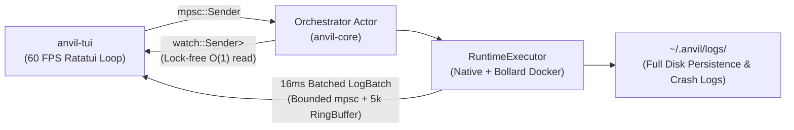
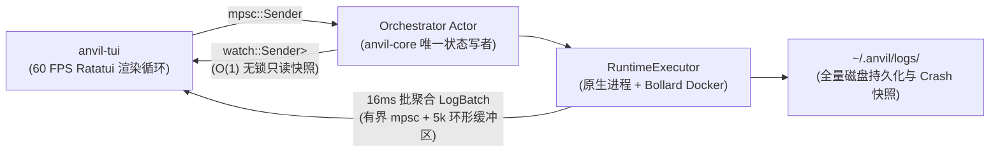

# Anvil

[English](#english) | [简体中文](#简体中文)

---

<a id="english"></a>

## English

**A Rust-native local development environment orchestrator (CLI + TUI) unifying host processes, Docker containers, DAG dependency scheduling, and OS-level process tree hygiene.**

[](https://www.rust-lang.org/)
[](https://tokio.rs/)
[](https://ratatui.rs/)
[](https://github.com/fussybeaver/bollard)
[](#)

### Why Anvil?

Modern full-stack development routinely mixes stateful infrastructure containers (PostgreSQL, Redis, Kafka) with native host processes (`cargo run`, `go run`, `pnpm dev`). Existing tools leave critical gaps:

| Capability | **Anvil** | `docker compose` | `Overmind` / `Foreman` | `Turborepo` |
| :--- | :---: | :---: | :---: | :---: |
| **Native + Docker Unified DAG** | ✅ First-class | ❌ Containers only | ❌ Processes only | ❌ JS/TS monorepos |
| **Readiness-Gated Startup** | ✅ TCP / HTTP / LogRegex / DockerHealth | ⚠️ Healthcheck only | ❌ Fire-and-forget | ⚠️ Task exit only |
| **True Process Tree Destruction** | ✅ Unix PGID + Win32 Job Object | ✅ Container isolation | ⚠️ Signal leaks on grandchildren | ⚠️ Node tree gaps |
| **Interactive Port Conflict Rescue** | ✅ Inspect PID/Cmd + 1-key kill & retry | ❌ Fails on bind | ❌ Fails on bind | ❌ Fails on bind |
| **Secret Isolation (Zero Plaintext)** | ✅ OS Keychain + AES-256-GCM + `zeroize` | ⚠️ `.env` plaintext files | ⚠️ `.env` plaintext files | ⚠️ `.env` plaintext files |
| **Single Static Binary & Cold Start** | ✅ Milliseconds (Rust) | ⚠️ Go CLI + Daemon | ⚠️ Requires `tmux` | ❌ Node.js runtime |

### Core Capabilities

- **Declarative Hybrid DAG Orchestration (`anvil.yaml`)**: Define native host processes, standalone Docker containers, and `docker compose` services in one manifest. Built-in cycle detection with exact cycle-path diagnostics (`a -> b -> a`) and event-driven topological wave execution.
- **Multi-Modal Readiness Probes**: Downstream services wait automatically until upstream dependencies pass `tcp`, `http`, `log_regex`, or `docker_health` readiness checks.
- **Zero-Orphan Cross-Platform Process Management**:
  - **Unix (macOS / Linux)**: Isolates child subtrees via `setpgid(0, 0)` and performs two-phase termination (`SIGTERM` -> grace period -> `SIGKILL`) across the entire process group (`killpg`).
  - **Windows**: Binds child processes to Win32 Job Objects with `JOB_OBJECT_LIMIT_KILL_ON_JOB_CLOSE` (RAII `Drop`) so even unexpected crashes leave zero stray grandchildren.
  - **PID-Reuse-Safe Crash Recovery**: Persists `{ pid, pgid, start_time_secs, exe_name }` fingerprints in `~/.anvil/run/<project>.lock.json` and validates kernel process start timestamps before reaping leftovers on restart.
- **Interactive Port Conflict Resolution**: Fast pre-flight bind probe (`TcpListener`) falls back to OS socket table + `sysinfo` process inspection upon collision, letting you inspect the occupying PID/command and press `Enter` -> `k` in the TUI to terminate and retry seamlessly.
- **Zero-Plaintext Secret Vault**: Reference secrets in `anvil.yaml` via `${SECRET:KEY}`. Values live in your OS native keychain (with an Argon2id + AES-256-GCM encrypted local fallback at `~/.anvil/vault/<project>.vault.enc`) and are injected directly into child memory wrapped in `zeroize::Zeroizing<String>`. Logs and crash snapshots automatically scrub secret values to `[REDACTED]`.
- **60 FPS Lock-Free TUI Workbench**: Powered by `ratatui` + `crossterm` with ANSI color log rendering, 16ms batched 5,000-line ring buffers, scroll locking, live keyword filtering, per-service hot restart, terminal panic recovery hooks, and automatic crash snapshot persistence (`~/.anvil/logs/<project>/crashes/<service>-<ts>.crash.yaml`).

### Installation & Quick Start

#### Build from Source

```bash
cargo build --release -p anvil-cli
# Binary output: target/release/anvil

# Or install into Cargo bin PATH:
cargo install --path crates/anvil-cli
```

#### Basic Workflow

```bash
# 1. Store declared secrets securely (OS Keychain by default, or --vault for encrypted file fallback)
anvil secret set DB_PASSWORD
anvil secret set JWT_PRIVATE_KEY --vault

# 2. Run 5-point environment preflight (Config/DAG, Secrets, Lockfile, Ports, Docker)
anvil doctor

# 3. Launch workspace in interactive 60 FPS TUI mode (default)
anvil up

# Or run foreground plain logs / detached background daemon:
anvil up --no-tui
anvil up --detach

# 4. Inspect status & follow logs when detached
anvil ps
anvil ps --json
anvil logs api-gateway -f -n 100

# 5. Stop all services in reverse topological order and clean up locks
anvil down
```

### CLI Reference

Global flags accepted before or after any subcommand:

- `-c, --config <PATH>`: Path to `anvil.yaml` (default: `./anvil.yaml`)
- `--data-dir <PATH>`: Override Anvil state root (default: `~/.anvil`)
- `-p, --project <NAME>`: Override project name from `anvil.yaml`

| Command | Description | Key Flags |
| :--- | :--- | :--- |
| `anvil up` | Reap verified orphans, resolve secrets, and orchestrate services | `-d, --detach`, `--no-tui` |
| `anvil down` | Stop services in reverse DAG wave order and clear lockfile | `--grace-ms <MS>` (default: `3000`) |
| `anvil ps` | Inspect live service status (`Running`, `Stale`, `PidReused`, `Stopped`) | `--json` |
| `anvil logs [SERVICE]` | Print or stream persisted service logs (`[service]` prefix when omitted) | `-f, --follow`, `-n, --tail <N>` (default: `100`) |
| `anvil secret <ACTION>` | Manage secrets (`set`, `get`, `list`, `delete`) | `--vault`, `--stdin` (on `set`; `ANVIL_VAULT_PASSPHRASE` env supported) |
| `anvil doctor` | Run 5-point diagnostic (`[PASS]` / `[WARN]` / `[FAIL]`) | `--reap` (clean verified orphan processes) |

### TUI Keybindings

| Mode | Key | Action |
| :--- | :--- | :--- |
| **Normal** | `Tab` | Switch focus between Topology pane and Logs pane |
| **Normal** | `j` / `k` or `↓` / `↑` | Select service (Topology focus) or scroll 1 line (Logs focus) |
| **Normal** | `Home` / `End` | Jump to oldest / newest log lines (Logs focus) |
| **Normal** | `r` | Graceful hot-restart of the currently selected service |
| **Normal** | `/` | Enter live search mode to filter the active service log buffer |
| **Normal** | `s` | Toggle auto-scroll lock in the log pane |
| **Normal** | `Enter` | Open Port Conflict or Crash Detail modal for the selected service |
| **Normal** | `q` / `Ctrl+C` | Reverse-topological graceful shutdown of all services & exit |
| **Search Input** | Text / `Backspace` | Edit literal log filter query |
| **Search Input** | `Enter` / `Esc` | Confirm filter (`Enter`) or clear filter & return (`Esc`) |
| **Port Conflict Modal** | `k` / `y` / `Enter` | Kill occupying external process and retry starting service |
| **Port Conflict Modal** | `n` / `Esc` | Dismiss modal |
| **Crash Detail Modal** | `Enter` / `Esc` | Dismiss crash detail overlay |

### System Architecture

Anvil enforces a **Single-Writer Actor** state model decoupled from UI rendering via lock-free snapshots and bounded, backpressure-protected Tokio channels:



### Example `anvil.yaml`

```yaml
version: "1"
project:
  name: "nebula-commerce"

secrets:
  - DB_PASSWORD
  - JWT_PRIVATE_KEY

services:
  postgres:
    runtime:
      type: docker_container
      image: "postgres:16-alpine"
      ports: ["5432:5432"]
    port: 5432
    env:
      POSTGRES_PASSWORD: "${SECRET:DB_PASSWORD}"
    readiness_probe:
      type: tcp
      port: 5432

  api-gateway:
    runtime:
      type: native
      cmd: "cargo run -p nebula-api"
      cwd: "./backend"
    port: 8080
    depends_on: [postgres]
    env:
      DATABASE_URL: "postgres://postgres:${SECRET:DB_PASSWORD}@127.0.0.1:5432/app"
      JWT_SECRET: "${SECRET:JWT_PRIVATE_KEY}"
    readiness_probe:
      type: http
      url: "http://127.0.0.1:8080/healthz"

  web-console:
    runtime:
      type: native
      cmd: "pnpm run dev --port 3000"
      cwd: "./frontend"
    port: 3000
    depends_on: [api-gateway]
    readiness_probe:
      type: log_regex
      pattern: "Local:\\s+http://localhost:3000"
```

### Cargo Workspace Layout

```text
crates/
├── anvil-cli       # Clap CLI router (up, down, ps, logs, secret, doctor), RAII terminal guard & E2E tests
├── anvil-core      # YAML schema, DAG scheduler, ServiceState machine, probes, Orchestrator, log ring & persistence
├── anvil-runtime   # RuntimeExecutor implementations (Native tokio::process + Bollard Docker / Compose)
├── anvil-sys       # Unix PGID, Win32 Job Objects (RAII), port inspection, PID-reuse-safe orphan reaper
├── anvil-secret    # OS Keychain + Argon2id/AES-256-GCM fallback vault + Zeroizing placeholder resolver
└── anvil-tui       # Ratatui 60 FPS terminal workbench, ANSI log pane, topology tree & interactive modals
```

### Development Roadmap

- [x] **Milestone 1**: Cargo Workspace setup, `anvil-secret` vault/resolver, `anvil.yaml` parser/validator, DAG scheduler & `ServiceState`
- [x] **Milestone 2**: `anvil-sys` cross-platform process tree destruction, port conflict inspector & orphan reaper
- [x] **Milestone 3**: `anvil-runtime` Native + Bollard Docker executors & multi-modal readiness probes
- [x] **Milestone 4**: `anvil-core` event-driven `Orchestrator` Actor, 16ms batched log ring buffer & crash persistence
- [x] **Milestone 5**: `anvil-tui` 60 FPS workbench & `anvil-cli` full command suite (`up`, `down`, `ps`, `logs`, `secret`, `doctor`, E2E tests)

### Verification

```bash
cargo test --workspace
cargo clippy --workspace --all-targets -- -D warnings
cargo check -p anvil-sys --target x86_64-pc-windows-gnu
```

---

<a id="简体中文"></a>

## 简体中文

**基于 Rust 原生构建的本地全栈开发环境编排器（CLI + TUI）—— 将宿主机进程、Docker 容器、DAG 拓扑调度与内核级进程树清理融为一体。**

### 为什么需要 Anvil？

现代全栈本地开发通常需要同时管理有状态基础设施容器（PostgreSQL、Redis、Kafka）与宿主机原生业务进程（`cargo run`、`go run`、`pnpm dev`）。现有工具在跨界编排与系统级管控上存在明显短板：

| 核心能力 | **Anvil** | `docker compose` | `Overmind` / `Foreman` | `Turborepo` |
| :--- | :---: | :---: | :---: | :---: |
| **原生进程 + Docker 统一 DAG** | ✅ 一等公民统一编排 | ❌ 仅限容器 | ❌ 仅限进程 | ❌ 偏重 JS/TS Monorepo |
| **多模态就绪探针门控** | ✅ TCP / HTTP / 日志正则 / DockerHealth | ⚠️ 仅容器 Healthcheck | ❌ 启动后即放任 | ⚠️ 仅任务退出码 |
| **跨平台进程树彻底销毁** | ✅ Unix 进程组 + Win32 Job Object | ✅ 容器隔离 | ⚠️ 多层子进程易产生信号泄漏 | ⚠️ Node 进程树残留 |
| **交互式端口冲突救援** | ✅ 反查占用 PID/命令 + 一键强杀重试 | ❌ 绑定失败直接退出 | ❌ 绑定失败直接退出 | ❌ 绑定失败直接退出 |
| **敏感凭证零明文隔离** | ✅ 系统钥匙串 + AES-256-GCM + `zeroize` | ⚠️ `.env` 明文文件 | ⚠️ `.env` 明文文件 | ⚠️ `.env` 明文文件 |
| **单二进制分发与冷启动** | ✅ 毫秒级冷启动（Rust 原生） | ⚠️ Go CLI + 守护进程 | ⚠️ 依赖 `tmux` | ❌ 依赖 Node.js 运行时 |

### 核心特性

- **声明式混合 DAG 编排 (`anvil.yaml`)**：在同一份配置文件中统一管理宿主机原生进程、独立 Docker 容器与 `docker compose` 服务；内置有向无环图环路检测（精准报错环路径 `a -> b -> a`）与事件驱动的波次并发启动。
- **多模态就绪探针 (`Readiness Probe`)**：下游服务自动等待上游依赖通过 `tcp`、`http`、`log_regex` 或 `docker_health` 探针后才触发启动，彻底告别手写 `sleep` 等待脚本。
- **跨平台零孤儿进程管理**：
  - **Unix (macOS / Linux)**：通过 `setpgid(0, 0)` 将子进程隔离至独立进程组，停止时执行两阶段清场（先广播 `SIGTERM` 给予优雅退出宽限期，超时后对整个进程组 `killpg` 发送 `SIGKILL`）。
  - **Windows**：将子进程绑定至启用了 `JOB_OBJECT_LIMIT_KILL_ON_JOB_CLOSE` 的 Win32 Job Object（RAII `Drop` 封装），即使主程序意外终止，内核也会自动销毁整棵派生进程树。
  - **PID 回绕安全防护**：将 `{ pid, pgid, start_time_secs, exe_name }` 进程启动时间戳指纹记录于 `~/.anvil/run/<project>.lock.json`，崩溃重启自检或离线清理时校验时间戳一致才回收残留进程，严防系统 PID 复用误杀无辜进程。
- **交互式端口冲突处置**：启动前使用 `TcpListener::bind` 进行毫秒级快速预检；发生占用冲突时自动通过 OS Socket 表与 `sysinfo` 反查外部占用进程的 PID、进程名及完整命令行，在 TUI 中按 `Enter` 打开弹窗并按 `k` 即可一键终止并无缝重试启动。
- **敏感配置零明文隔离**：`anvil.yaml` 中使用 `${SECRET:KEY}` 占位符声明敏感变量，可安全提交至 Git；实际密钥存放于系统原生钥匙串（或无桌面环境下的 Argon2id + AES-256-GCM 加密文件 `~/.anvil/vault/<project>.vault.enc`），启动服务时通过 `zeroize::Zeroizing<String>` 直接注入内存并自动清零，日志流与崩溃快照均自动脱敏为 `[REDACTED]`。
- **60 FPS 无锁响应式 TUI 工作台**：基于 `ratatui` + `crossterm` 实现左右分屏布局，支持 ANSI 原色日志渲染、16ms 批聚合背压保护与定长 5,000 行环形缓冲区、滚动锁定、关键字实时过滤、单服务热重启、Panic 终端自动恢复 Hook 以及崩溃上下文自动落盘（`~/.anvil/logs/<project>/crashes/<service>-<ts>.crash.yaml`）。

### 安装与快速上手

#### 从源码构建

```bash
cargo build --release -p anvil-cli
# 生成可执行文件：target/release/anvil

# 或安装到 Cargo 全局 PATH：
cargo install --path crates/anvil-cli
```

#### 标准工作流

```bash
# 1. 写入配置中声明的密钥（默认存入系统钥匙串，可用 --vault 强制使用本地加密 Vault）
anvil secret set DB_PASSWORD
anvil secret set JWT_PRIVATE_KEY --vault

# 2. 执行 5 维环境诊断自检（配置/DAG、密钥、孤儿锁、端口冲突、Docker 连通性）
anvil doctor

# 3. 启动全栈工作区（默认进入 60 FPS 交互式 TUI）
anvil up

# 或使用无 TUI 前台日志模式 / 后台分离模式：
anvil up --no-tui
anvil up --detach

# 4. 查看运行态与实时日志
anvil ps
anvil ps --json
anvil logs api-gateway -f -n 100

# 5. 按逆拓扑顺序优雅停止所有服务并清理锁文件
anvil down
```

### CLI 命令速查

全局参数（可放在子命令前后）：

- `-c, --config <PATH>`：指定 `anvil.yaml` 路径（默认 `./anvil.yaml`）
- `--data-dir <PATH>`：覆盖 Anvil 数据根目录（默认 `~/.anvil`）
- `-p, --project <NAME>`：覆盖配置中的项目名

| 命令 | 说明 | 常用选项 |
| :--- | :--- | :--- |
| `anvil up` | 自检回收孤儿、解析密钥并启动服务编排 | `-d, --detach`、`--no-tui` |
| `anvil down` | 按逆拓扑分层停止服务并清理工作区锁 | `--grace-ms <MS>`（默认 `3000`） |
| `anvil ps` | 查看服务实时状态（`Running` / `Stale` / `PidReused` / `Stopped`） | `--json` |
| `anvil logs [SERVICE]` | 查看或追踪持久化日志（省略服务名时聚合全部服务并标 `[service]`） | `-f, --follow`、`-n, --tail <N>`（默认 `100`） |
| `anvil secret <ACTION>` | 管理项目密钥（`set` / `get` / `list` / `delete`） | `--vault`、`--stdin`（支持 `ANVIL_VAULT_PASSPHRASE` 环境变量） |
| `anvil doctor` | 执行 5 维环境自检（`[PASS]` / `[WARN]` / `[FAIL]`） | `--reap`（自动清理已核验孤儿进程树） |

### TUI 交互快捷键一览

| 模式 | 快捷键 | 功能描述 |
| :--- | :--- | :--- |
| **常规模式** | `Tab` | 在左侧拓扑树与右侧日志面板之间切换焦点 |
| **常规模式** | `j` / `k` 或 `↓` / `↑` | 拓扑焦点下切换选中服务；日志焦点下逐行滚动日志 |
| **常规模式** | `Home` / `End` | 日志焦点下跳转至日志顶部 / 底部最新行 |
| **常规模式** | `r` | 优雅停止并热重启当前选中的单个服务 |
| **常规模式** | `/` | 进入关键字搜索输入模式，实时过滤当前服务日志 |
| **常规模式** | `s` | 切换日志面板的自动滚动锁定状态 |
| **常规模式** | `Enter` | 若选中服务处于端口冲突或崩溃状态，打开对应详情弹窗 |
| **常规模式** | `q` / `Ctrl+C` | 按逆拓扑顺序优雅停止所有服务、清理进程树并退出 |
| **搜索模式** | 文本输入 / `Backspace` | 编辑日志字面量过滤关键字 |
| **搜索模式** | `Enter` / `Esc` | `Enter` 确认保留过滤结果；`Esc` 清空过滤并返回 |
| **端口冲突弹窗** | `k` / `y` / `Enter` | 强杀占用端口的外部进程并立即重试启动服务 |
| **端口冲突弹窗** | `n` / `Esc` | 关闭弹窗（忽略本次提示） |
| **崩溃详情弹窗** | `Enter` / `Esc` | 关闭崩溃详情弹窗 |

### 系统架构与并发通信模型

Anvil 采用 **Single-Writer Actor（单写者状态引擎）** 架构，通过无锁快照与有界背压通道将核心调度逻辑与终端渲染彻底解耦：



### `anvil.yaml` 配置示例

```yaml
version: "1"
project:
  name: "nebula-commerce"

secrets:
  - DB_PASSWORD
  - JWT_PRIVATE_KEY

services:
  postgres:
    runtime:
      type: docker_container
      image: "postgres:16-alpine"
      ports: ["5432:5432"]
    port: 5432
    env:
      POSTGRES_PASSWORD: "${SECRET:DB_PASSWORD}"
    readiness_probe:
      type: tcp
      port: 5432

  api-gateway:
    runtime:
      type: native
      cmd: "cargo run -p nebula-api"
      cwd: "./backend"
    port: 8080
    depends_on: [postgres]
    env:
      DATABASE_URL: "postgres://postgres:${SECRET:DB_PASSWORD}@127.0.0.1:5432/app"
      JWT_SECRET: "${SECRET:JWT_PRIVATE_KEY}"
    readiness_probe:
      type: http
      url: "http://127.0.0.1:8080/healthz"

  web-console:
    runtime:
      type: native
      cmd: "pnpm run dev --port 3000"
      cwd: "./frontend"
    port: 3000
    depends_on: [api-gateway]
    readiness_probe:
      type: log_regex
      pattern: "Local:\\s+http://localhost:3000"
```

### Cargo Workspace 模块划分

```text
crates/
├── anvil-cli       # Clap 命令行路由 (up, down, ps, logs, secret, doctor)、终端 Panic 恢复与端到端测试
├── anvil-core      # YAML 协议校验、DAG 调度器、ServiceState 状态机、就绪探针、Orchestrator Actor 与持久化
├── anvil-runtime   # RuntimeExecutor 混合执行器实现 (tokio::process 原生进程 + Bollard Docker / Compose)
├── anvil-sys       # Unix 进程组、Win32 Job Object (RAII)、两阶段端口反查、PID 时间戳防误杀回收器
├── anvil-secret    # OS 钥匙串 + Argon2id/AES-256-GCM 加密回退 Vault + Zeroizing 占位符解析器
└── anvil-tui       # Ratatui 60 FPS 终端交互工作台、ANSI 日志视图、拓扑树与端口冲突/崩溃弹窗
```

### 开发路线图

- [x] **Milestone 1**：Cargo Workspace 骨架、`anvil-secret` 安全凭证库、`anvil.yaml` 校验器、DAG 拓扑调度器与 `ServiceState`
- [x] **Milestone 2**：`anvil-sys` 跨平台进程树彻底销毁、两阶段端口反查与残留进程回收器
- [x] **Milestone 3**：`anvil-runtime` 原生与 Bollard Docker 执行器、四模态就绪探针
- [x] **Milestone 4**：`anvil-core` 事件驱动 `Orchestrator` Actor、16ms 批聚合环形日志缓存与 Crash 上下文落盘
- [x] **Milestone 5**：`anvil-tui` 60 FPS 工作台与 `anvil-cli` 全子命令交付（含端到端生命周期集成测试）

### 验证命令

```bash
cargo test --workspace
cargo clippy --workspace --all-targets -- -D warnings
cargo check -p anvil-sys --target x86_64-pc-windows-gnu
```
